<a href="https://vwave.me">
  <picture>
    <source media="(prefers-color-scheme: dark)" srcset="assets/header-dark.svg">
    
  </picture>
</a>

 

<samp>
  <a href="https://vwave.me">vwave.me</a>&nbsp;&nbsp;&nbsp;
  <a href="https://zcal.co/vwave/30min">book&nbsp;a&nbsp;call</a>&nbsp;&nbsp;&nbsp;
  <a href="https://vwave.me/portfolio">portfolio</a>&nbsp;&nbsp;&nbsp;
  <a href="https://vwave.me/fun-sites">fun&nbsp;sites</a>&nbsp;&nbsp;&nbsp;
  <a href="https://vwave.me/resume.pdf">resume</a>
</samp>

 
 

<h3><samp>work</samp></h3>

  <samp><a href="https://github.com/VesselWave/wave-remote"><b>wave-remote</b></a></samp> 
  <samp>a tiny, private android remote for lg webos tvs. no account, no cloud.</samp> 
  <samp>java &nbsp;·&nbsp; <a href="https://remote.vwave.me">remote.vwave.me</a></samp>

  <samp><a href="https://github.com/VesselWave/supabase-backup"><b>supabase-backup</b></a></samp> 
  <samp>backup and restore for supabase: schemas, data, edge functions, storage.</samp> 
  <samp>python &nbsp;·&nbsp; podman &nbsp;·&nbsp; borg</samp>

  <samp><a href="https://github.com/VesselWave/go-voice-app"><b>go-voice-app</b></a></samp> 
  <samp>answers sip calls, listens with whisper.cpp, talks back with piper.</samp> 
  <samp>go &nbsp;·&nbsp; sip/rtp &nbsp;·&nbsp; cuda</samp>

  <samp><a href="https://github.com/VesselWave/xmppm"><b>xmppm</b></a></samp> 
  <samp>config and ops for xmp.pm, an invite-only, donation-funded xmpp server.</samp> 
  <samp>typescript &nbsp;·&nbsp; ejabberd &nbsp;·&nbsp; <a href="https://xmp.pm">xmp.pm</a></samp>

  <samp><a href="https://github.com/VesselWave/vgush-demo"><b>vgush-demo</b></a></samp> 
  <samp>eight interactive webgpu shader experiments.</samp> 
  <samp>typescript &nbsp;·&nbsp; webgpu &nbsp;·&nbsp; <a href="https://vgush.vercel.app">vgush.vercel.app</a></samp>

 

<samp><a href="https://x.com/vesselwave">x</a>&nbsp;&nbsp;&nbsp;<a href="https://www.linkedin.com/in/vladyslav-vasko-8b75a92aa/">linkedin</a>&nbsp;&nbsp;&nbsp;<a href="https://gitlab.com/VesselWave">gitlab</a>&nbsp;&nbsp;&nbsp;<a href="mailto:vesselwave@protonmail.com">mail</a></samp>
